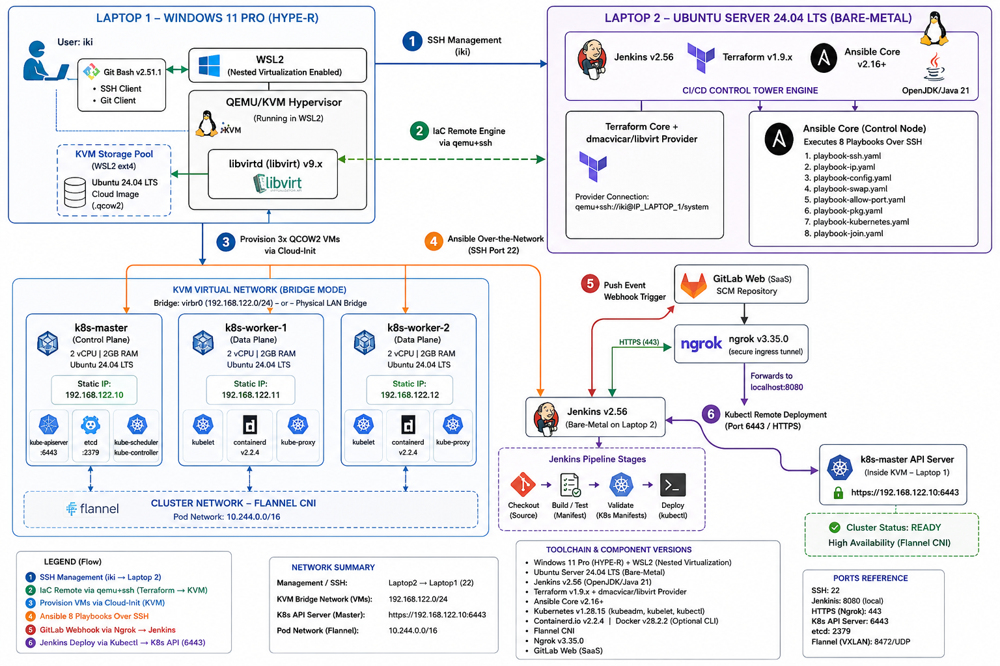

Topik berikutnya benar-benar menguras tenaga dan pikiran saya,sebelumnya saya sudah pernah mengatakan jika saya ingin sekali menggunakan terraform namun saya tidak punya uang untuk sewa cloud ataupun menggunakan proxmox karena laptop 2 saya itu tidak mumpuni secara spesifikasi,makanya saya dengan tekad dan semangat saya yang membara mencara cara agar saya bisa belajar terraform, akhirnya setelah beberapa hari kebingungan harus bagaimana saya menemunkan video lama dari adinusa di youtube membahas tentang Terraform dan QEMU/KVM,saya tonton videonya dan saya menemukan resource akun github dan docs di terraform blogspot,topik kali ini menggabungkan beberapa tools seperti kubernetes,ansible,terraform,jenkins,QEMU/KVM,libvirt sebagai api,dll. Tidak usah berlama-lama lagi langsung gaskannnn
| Node        | CPU     | RAM  | Storage | Network                             |
|-------------|---------|------|---------|------------------------------------ |
| **Master**  | 2 cores | 2GB  | 10GB    | 1 Adapters   ( DHCP Ip )            |
| **Worker 1**| 2 cores | 2GB  | 10GB    | 1 Adapters   ( DHCP Ip )            |
| **Worker 2**| 2 cores | 2GB  | 10GB    | 1 Adapters   ( DHCP Ip )            |
| **Jenkins** | 7 cores | 7GB  | 240GB   |                Wlan                 |



### Reasoning
Kenapa saya memilih menggunakan KVM/QEMU karena saya ingin sekali belajar terraform dan ada beberapa opsi seperti menggunakan cloud provider ataupun menggunakan proxmox,jika saya 
menggunakancloud provider sperti aws,azure,gcp saya harus memmiliki banyak uang terlebih dahulu dan saya tidak punya banyak uang untuk sewa cloud , dan jika saya memilih opsi menggunakan 
proxmox laptop 2 saya harus mempunya spesifikasi yang memumpuni sedangkan laptop 2 saya tidak memiliki spesifikasi yang mumpuni,dan jika saya menggunakan vmware biasa atau virtualbox 
tidak ada docs yang kredibel ataupun developer yang proper mendokumentasikannya,jadinya saya menggunakan KVM/QEMU dan libvirt sebagai api.Libvirt memiliki Terraform provider aktif 
(dmacvicar/libvirt), dan libvirt menyediakan API yang stabil untuk manajemen VM secara programatik. Ini juga teknologi yang sama digunakan di production environment OpenStack dan banyak 
private cloud.

### Structure Folder 

Untuk structure folder yang digunakan dalam projek ini ada dua yang pertama itu untuk terraform dan yang kedua itu ansible

```
terraform-setup/
├── .terraform/
├── compute.tf
├── main.tf
├── prep-vm.tf
```

dan yang kedua yaitu ansible

```
k8s/
├── ansible.cfg
├── inventory
├── playbook-allow-port.yaml
├── playbook-enable-service-baremetal.yaml
├── playbook-ip.yaml
├── playbook-install-java-baremetal.yaml
├── playbook-install-jenkins-baremetal.yaml
├── playbook-install-kubectl-baremetal.yaml
├── playbook-join.yaml
├── playbook-kubernetes.yaml
├── playbook-pkg.yaml
├── playbook-swap.yaml
├── playbook-install-terraform-bare-metal.yaml
├── playbook-config.yaml
```


### Tools
- **Wsl** : v0.2.1
- **Terraform** : v1.16
- **Docker** : v29.1.3
- **OS Laptop 1** : Windows 11 Pro
- **OS WSL2 Subsystem** : Ubuntu 24.04 LTS
- **OS Ubuntu VM (K8s Nodes)** : 22.04 LTS
- **OS Ubuntu Jenkins Node (Bare Metal)** : 25.04
- **Kubernetes** : 1.28
- **Containerd** : 2.2.4
- **Java** : 21
- **Jenkins** : 2.56
- **Network** : Flannel
- **Ansible** : v2.16+
- **KVM** : 8.2.2
- **QEMU** : 8.2.2
- **Libvirt** : 10.0.0


### Catatan Kompatibilitas
Dites pada: VM Ubuntu 22.04 (jammy, dari image cloud) dan node Jenkins Ubuntu 25.04.
Kalau memakai rilis Ubuntu lain, alur playbook dan module-nya sama. Yang perlu
disesuaikan hanya yang bergantung pada codename rilis:
- HashiCorp: ubah `hashicorp_suite` bila suite rilis belum ada di repo mereka.
- Docker: pastikan `download.docker.com` sudah punya suite untuk rilis tersebut.
- Terraform: ganti URL image di `prep-vm.tf`.
